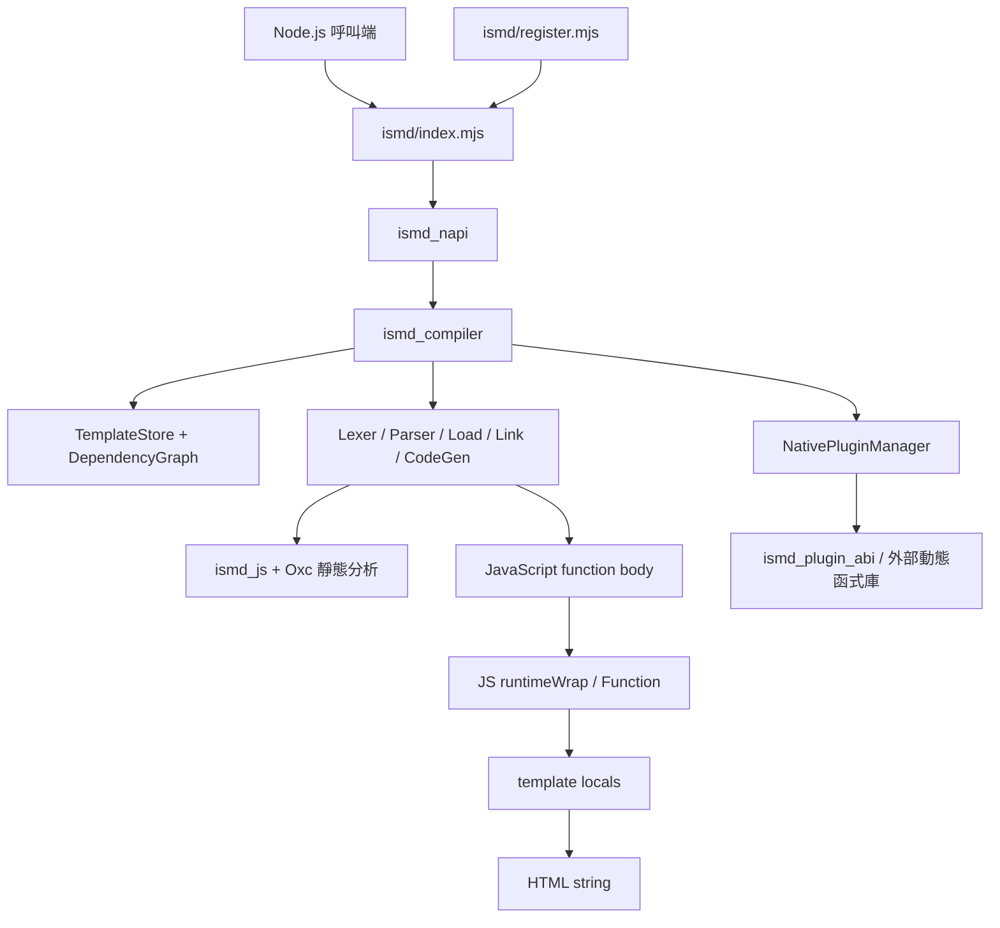
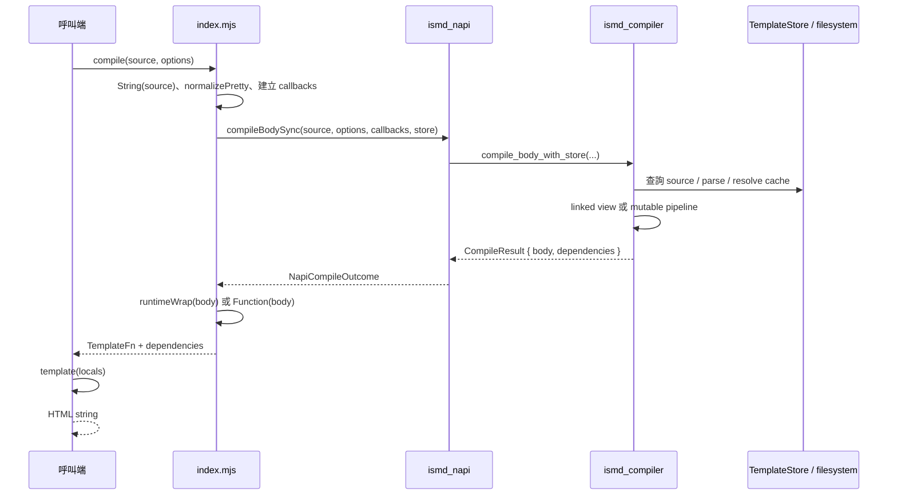
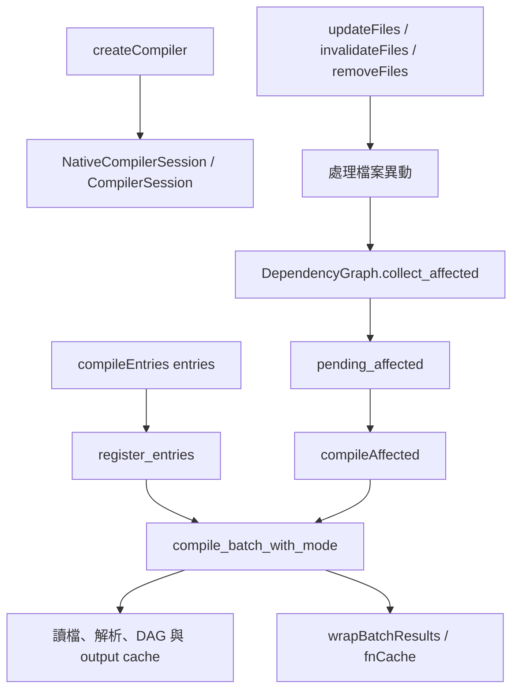

# ISMD 系統架構與執行流程

本文件以 `2026-11-16` 的 `dev` 原始碼為準，分析範圍是 `ismd/` 的 Rust 與 JavaScript 實作。主 JavaScript 模組使用 `.mjs`；`tests/cases/**/*.js` 是模板引用的測試輸入。其他 workspace package 僅用於辨識系統邊界，未在此宣稱其功能已驗證。完整方法與 Arguments／Return 見 [Rust API](rust-api.md) 與 [JavaScript API](javascript-api.md)。

## 1. 系統定位與邊界

ISMD 是模板編譯函式庫。Rust 將模板轉成 JavaScript 函式原始碼，Node.js 包裝並執行該函式，傳回 HTML 字串；不是由 Rust 直接執行一般 JavaScript 表達式。入口是 [ismd/index.mjs：compile、render](../../index.mjs#L952)，原生邊界是 [ismd_napi::compile_body_sync](../../crates/ismd_napi/src/lib.rs#L1265)，JavaScript 包裝器是 [runtime/wrap.mjs](../../runtime/wrap.mjs#L3)。

在此範圍未找到 HTTP 路由、控制器、帳號認證、資料庫連線或部署中的伺服器。`__express` 是呼叫 `renderFile` 的 view-engine 相容介面，並未建立 Express application。參考 [__express](../../index.mjs#L1029)、[儲存模型](database.md)、[建置與部署](deployment.md)。

根目錄 [package.json](../../../package.json) 宣告 `ismd`、`ismd-cli`、`vite-plugin-ismd`、`ismd-webpack-plugin`、`ismd-filters`、`ismd-lint`、`benchmarks` workspaces。這些是目前真實目錄名稱；本文件不沿用舊路徑 `ismd/` 或 `packages/vite/` 描述現有檔案。

## 2. 模組責任

Rust workspace 共列出 15 個 crate，依據 [ismd/Cargo.toml](../../Cargo.toml#L1)。下表列流程責任，不把 crate 誤寫成 class。

| 模組／來源 | 責任與主要輸出 |
|---|---|
| [index.mjs](../../index.mjs#L13) | 載入 addon、選項正規化、JS plugin bridge、快取、單檔／批次／session API |
| [ismd_napi](../../crates/ismd_napi/src/lib.rs#L1265) | N-API DTO、Rust/JS 值轉換、同步 host callback、例外轉換 |
| [ismd_compiler](../../crates/ismd_compiler/src/lib.rs#L671) | 組合編譯階段、host hooks、依賴收集、store 與 native plugin 選擇 |
| [ismd_ast](../../crates/ismd_ast/src/lib.rs) | `Token`、位置資訊、`BlockNode`／`Node`／各種節點，以及 profiling 結構 |
| [ismd_error](../../crates/ismd_error/src/lib.rs#L28) | `IsmdError` 與序列化錯誤資料 |
| [ismd_js](../../crates/ismd_js/src/lib.rs#L1) | Oxc allocator 重用、表達式驗證、常數分析、scope/free variables、locals 改寫 |
| [ismd_lexer](../../crates/ismd_lexer/src/lib.rs#L74) | 模板字串 → `Vec<Token>`；含 lexer hook 與 generic syntax |
| [ismd_strip_comments](../../crates/ismd_strip_comments/src/lib.rs#L112) | token stream 註解處理 |
| [ismd_parser](../../crates/ismd_parser/src/lib.rs#L42) | token stream → `BlockNode`，另回傳 warnings |
| [ismd_walk](../../crates/ismd_walk/src/lib.rs#L86) | typed／JSON AST 遍歷、替換及可變節點走訪 |
| [ismd_load](../../crates/ismd_load/src/lib.rs#L59) | 透過 `LoadHost` 遞迴解析 include／extends／raw include |
| [ismd_linker](../../crates/ismd_linker/src/lib.rs#L14) | 將繼承、named block、include 等組合成可產生程式碼的 AST |
| [ismd_attrs](../../crates/ismd_attrs/src/lib.rs#L21) | 屬性輸出程式碼與靜態屬性字串生成 |
| [ismd_code_gen](../../crates/ismd_code_gen/src/lib.rs#L68) | `BlockNode`／overlay → JavaScript 原始碼 |
| [ismd_runtime](../../crates/ismd_runtime/src/lib.rs#L85) | 按 helper 依賴組成可 inline 的 JavaScript runtime 原始碼 |
| [ismd_plugin_abi](../../crates/ismd_plugin_abi/src/lib.rs#L218) | `repr(C)` descriptor／request／response 與 function pointer 契約 |
| [runtime/index.mjs](../../runtime/index.mjs) | 生成函式執行時使用的 JS escape、attrs、classes、style、rethrow 等 helper |

## 3. 單檔編譯與渲染

入口差異必須保留：

| 呼叫 | 實際流程 |
|---|---|
| `compile(str, options)` | 將 `str` 轉為字串、編譯並包裝函式；不經 `handleTemplateCache` 的 JS function cache |
| `compileFile(path, options)` | 設定 `options.filename`，由 `handleTemplateCache` 讀檔或取得函式快取 |
| `render(str, options)` | `handleTemplateCache(options, str)(options)`；同一個 options 物件也傳作 locals |
| `renderFile(path, options)` | 設定 filename，讀檔／查快取，再傳 options 作 locals |
| callback overload | `render`／`renderFile` 同步執行 callback，不是 Promise 或背景工作 |

證據：[handleTemplateCache](../../index.mjs#L901)、[compile](../../index.mjs#L952)、[compileFile](../../index.mjs#L980)、[render](../../index.mjs#L986)。快取的鍵與限制另見 [database.md](database.md)。

### 3.1 Mutable AST 管線

[compile_body_with_store](../../crates/ismd_compiler/src/lib.rs#L679) 的一般流程為：

1. 選擇／載入 native plugins；需要時把其 syntax rules 放入有效選項。
2. `Session::lex_and_parse`：能命中 parse cache 時使用已解析 AST；否則進入 lexer／strip comments／parser。
3. 每檔解析時，依序 `preLex → lex → postLex → path token 補 .ismd → strip_comments → preParse → parse`；未使用快取的 hook 路徑繼續 `postParse → preLoad`。
4. `load_ast` 遞迴讀取並解析相依模板，之後 `postLoad`；記錄 dependency DAG。
5. `preTransform → native transform_ast（有 plugin 時）→ postTransform`。
6. `preLink → link → postLink`。
7. `preCodeGen → custom_generate_code 或 generate_code → postCodeGen`。
8. 回傳 `CompileResult { body: String, dependencies: Vec<String> }`。

證據：[Session::lex_and_parse](../../crates/ismd_compiler/src/lib.rs#L403)、[lex_strip_and_parse_with_store](../../crates/ismd_compiler/src/lib.rs#L496)、[LoadHost for Session](../../crates/ismd_compiler/src/lib.rs#L574)、[CompilerHost](../../crates/ismd_compiler/src/lib.rs#L66)。階段 hook 是有條件的 callback，不表示每次編譯都會跨 N-API 傳輸整棵 AST。

### 3.2 Linked view 路徑

無 native plugin 時，compiler 會先嘗試 [try_compile_linked_view](../../crates/ismd_compiler/src/linked_view.rs#L78)。此路徑保留 `Arc<ParsedTemplate>`，建立 `LinkedView` 的 named-block segments、include/raw include view、mixin 引用，再呼叫 `generate_code_with_overlay`。`ViewArena` 保存引用所需資料，並非另一份資料庫。

以下情況可能回到 mutable 管線：host 不支援 linked view、存在 lexer plugin methods、解析出的模板含 extension，或 include 指向本身有 extends 的模板。詳細判斷以該函式與遞迴載入函式為準，不應假設所有 include／extends 均走同一路徑。

Node host 只有在沒有 custom resolve/read、lex/parse hooks、AST/codegen hooks 時才宣告支援此路徑，見 [NodeHostAdapter::supports_linked_view](../../crates/ismd_napi/src/lib.rs#L960)。`DefaultHost` 支援此路徑，見 [DefaultHost](../../crates/ismd_compiler/src/lib.rs#L190)。

### 3.3 Oxc、Rust 與 JavaScript 的分工

- 模板解析及 JavaScript 產生在 Rust；`ismd_js` 使用 Oxc 分析表達式及作用域，並有自己的 `ConstVal` 常數求值。
- Oxc allocator 是 thread-local、每次操作後 reset 的重用池，並未作為跨 session 持久化的 AST database。
- 最終函式透過 JavaScript `Function` 建立，真正的 locals、動態 expression 與 HTML 字串組合在 Node.js 執行。

證據：[ismd_js/lib.rs](../../crates/ismd_js/src/lib.rs#L23)、[expression.rs](../../crates/ismd_js/src/expression.rs#L204)、[constant.rs](../../crates/ismd_js/src/constant.rs#L481)、[runtime/wrap.mjs](../../runtime/wrap.mjs#L3)。

## 4. 批次編譯與增量 Session

`createCompiler()` 建立 `NativeCompilerSession`、JS `fnCache` 與 disposed flag，回傳 object literal；沒有宣告 JS `class CompilerSession`。Rust 的 [CompilerSession](../../crates/ismd_compiler/src/session.rs#L67) 才以 struct 保存 store、default options、registered entries、path index 與 pending affected indices。

實際語意：

- `compileEntries` 註冊 entry，再按 `ParallelMode` 選擇 `.par_iter()` 或 `.iter()`；預設 `Auto(8)`。JS 呼叫仍是同步，並不回傳 Promise。[session.rs](../../crates/ismd_compiler/src/session.rs#L382)
- `updateFiles` 更新虛擬來源；相同內容可回報 `changed: false`。`invalidateFiles` 使來源快取失效；`removeFiles` 移除 session/store 中的路徑及相關 entry，不是刪磁碟檔案。[session.rs](../../crates/ismd_compiler/src/session.rs#L128)
- `removeFiles` 先整理 registered entries，再用尚未移除的 DAG 計算受影響項目，最後才 `store.remove_path` 移除來源、ID 對照與 DAG 邊。不能先刪邊再尋找受影響 entry。[remove_files](../../crates/ismd_compiler/src/session.rs#L192)
- `compileAffected` 消耗 pending queue，沒有待處理項目時回傳空陣列。檔案變動必須由呼叫端送入；核心沒有自動檔案 watcher。[session.rs](../../crates/ismd_compiler/src/session.rs#L338)
- JS host customization 命中 `hasHostCustomizations` 時，批次呼叫改走逐筆 `compileBatchFallbackEntry`。這個判斷只檢查實作中列出的 hooks，不能將所有 plugin 都視為有相同 fallback 行為。[index.mjs](../../index.mjs#L1116)
- Native batch 的 `entry.options` 會取代 default options；fallback 路徑則使用物件展開合併，兩者並不相同。[session.rs](../../crates/ismd_compiler/src/session.rs#L479)、[fallback](../../index.mjs#L1245)

## 5. 擴充與錯誤邊界

JS plugin bridge 由 `compileBody` 將存在的 hooks 建成 callbacks，N-API 的 `NodeHostAdapter` 實作 `CompilerHost`。Native plugin 則以 `ismd_plugin_entry_v1` 載入 descriptor、檢查 ABI，使用 `transform_fn` 改寫 extension 節點；未宣告 thread-safe capability 時以 mutex 保護呼叫。這是兩條不同的擴充路徑。證據：[JS bridge](../../index.mjs#L662)、[plugin.rs](../../crates/ismd_compiler/src/plugin.rs#L18)、[ABI](../../crates/ismd_plugin_abi/src/lib.rs#L209)。

`IsmdSyntaxKind::IncludePrefix` 在 ABI 註解中標為保留用途，不應寫成已完成的 resource hook。原碼中的 enum 宣告本身不構成已支援功能的證據。[ismd_plugin_abi/lib.rs](../../crates/ismd_plugin_abi/src/lib.rs#L136)

一般編譯錯誤以 `IsmdError` 轉成 DTO，再由 JS 建成附 `code`、`msg`、`line`、`column`、`filename`、`src` 的 Error；host exception 使用 plain error 欄位或原始 JS error。`compile_body_sync` 攔截 Rust panic，batch 另在每筆 entry 邊界攔截 panic。這些不是 HTTP status code。[N-API compile boundary](../../crates/ismd_napi/src/lib.rs#L1265)、[batch panic boundary](../../crates/ismd_compiler/src/session.rs#L447)

## 6. 交接閱讀順序

先讀 [JavaScript API](javascript-api.md) 選入口，再依本頁流程進入 [Rust API](rust-api.md) 對應 crate；涉及快取／檔案變動時讀 [database.md](database.md)，本機建置與測試讀 [deployment.md](deployment.md)。常見維護工作對照見 [developer-guide.md](developer-guide.md)。
