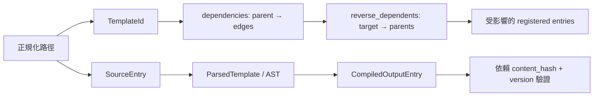

# ISMD 資料模型與快取生命週期

查證日期：2026-11-16。範圍為 `ismd/` 的 Rust、JavaScript、套件設定與測試；以下是原始碼描述，並非資料庫設計提案。

## 1. 資料庫實作狀態

在本次檢查的 `ismd/` 原始碼與 manifests 中，未找到 SQL/NoSQL driver、資料庫連線、migration、資料表或持久化快取實作。因此沒有可列出的資料表、主鍵、外鍵、交易或備份程序。實際資料來源是模板檔案與呼叫者傳入的字串；快取由程序內的 Rust `HashMap`、`Arc`、`RwLock` 及 JavaScript object/`Map` 管理。依據：[Cargo.toml](../../Cargo.toml#L26)、[TemplateStore](../../crates/ismd_compiler/src/store.rs#L159)、[load_or_read_disk](../../crates/ismd_compiler/src/store.rs#L338)、[createCompiler](../../index.mjs#L1268)。

下文的「鍵」是記憶體容器的 lookup key，不是資料庫主鍵；`TemplateId` 也不是跨程序持久識別碼。

## 2. TemplateStore 容器

來源：[store.rs / TemplateStore](../../crates/ismd_compiler/src/store.rs#L159)。除原子計數器外，各 map 由 `RwLock` 保護；來源與 AST/輸出物件使用 `Arc` 分享。

| 欄位 | Rust 型別 | 索引與內容 |
|---|---|---|
| `path_ids` | `RwLock<HashMap<String, TemplateId>>` | 正規化路徑 → 模板 ID |
| `id_paths` | `RwLock<HashMap<TemplateId, String>>` | 模板 ID → 正規化路徑 |
| `sources` | `RwLock<HashMap<String, Arc<SourceEntry>>>` | 正規化路徑 → 目前來源內容 |
| `parsed` | `RwLock<HashMap<ParseKey, CacheSlot<ParsedTemplate>>>` | 解析條件 → 不可變 AST 與 metadata |
| `resolved` | `RwLock<HashMap<ResolutionKey, String>>` | 相對路徑、來源與 basedir → resolve 結果 |
| `outputs` | `RwLock<HashMap<CompiledOutputKey, CacheSlot<CompiledOutputEntry>>>` | 來源版本、編譯選項 → JavaScript body |
| `dag` | `DependencyGraph` | 模板依賴及反向被依賴關係 |
| `plugins` | `RwLock<NativePluginManager>` | 載入的 native plugins 與 syntax rules |
| `trust_cached_sources` | `bool` | 是否信任已快取來源，免除再次讀檔 |
| `next_id`, `next_version`, `cache_tick` | `AtomicU64` | ID、內容版本與使用次序，初始化為 `1` |
| `source_hits/misses`, `parse_hits/misses`, `output_cache_hits/misses` | `AtomicU64` | 快取統計，初始化為 `0` |

`CacheSlot<V>` 包含 `value: Arc<V>` 與 `last_used: AtomicU64`，讀取時更新使用次序。見 [CacheSlot](../../crates/ismd_compiler/src/store.rs#L134)。

### 哪個入口使用哪個 store

| JS 入口 | 沒有指定 templateStore | 更新與共享範圍 |
|---|---|---|
| `compile`／正常 `compileBatch` | 程序全域 `hash_validated()` store | 讀磁碟內容作驗證；不持有 session 的 entries／pending |
| `createTemplateStore()` | 建立新的 `TemplateStore::new()`，信任已快取來源 | 可用 updateVirtualSource／invalidatePath 管理來源；本身沒有 entry 清單 |
| `createCompiler()` | 新 session 自有 `TemplateStore::new()` | 檔案事件由呼叫端傳入 update／invalidate／remove；有 registered entries／pending |
| 上述入口指定同一 templateStore | 共享傳入的底層 `Arc<TemplateStore>` | 共享來源、解析／輸出快取與 DAG；各 session 的 entries／pending、JS fnCache 仍各自保存 |

來源：[NativeTemplateStore::new](../../crates/ismd_napi/src/lib.rs#L1227)、[compile_body_sync](../../crates/ismd_napi/src/lib.rs#L1265)、[NativeCompilerSession::new](../../crates/ismd_napi/src/lib.rs#L1518)、[compile_batch_sync](../../crates/ismd_napi/src/lib.rs#L1629)。`compileFile`／`render*` 還可能先命中 JS filename cache，這時不會再次進入上述 Rust 來源驗證。

共享 store 不是共享 session：對一個 session 呼叫 `clear()`／`dispose()` 會清掉該 store 的快取與 DAG，會影響其他共用者；但不會自動重設其他 session 的 entries／pending／JS fnCache。若不需要協調這些生命週期，可讓每個 `createCompiler()` 使用自有 store。這是由 `with_store` 與 `clear` 的實作導出的影響，不是自動跨 session 通知功能。[CompilerSession](../../crates/ismd_compiler/src/session.rs#L80)、[clear](../../crates/ismd_compiler/src/session.rs#L362)

## 3. 記錄與複合鍵

### SourceEntry

來源：[SourceEntry](../../crates/ismd_compiler/src/store.rs#L50)、[upsert_disk_bytes](../../crates/ismd_compiler/src/store.rs#L358)、[update_virtual_source_checked](../../crates/ismd_compiler/src/store.rs#L404)。

| 欄位 | 型別 | 意義 |
|---|---|---|
| `id` | `TemplateId`，內含 `u64` | 由 store 對正規化路徑分配 |
| `normalized_path` | `String` | 快取索引用路徑 |
| `canonical_path` | `String` | 寫入時的 `full_path.to_string()`；這兩個寫入方法沒有呼叫 filesystem canonicalize |
| `raw` | `CachedRaw` | `Bytes(Arc<Vec<u8>>)` 或 `Text(Arc<str>)` |
| `text` | `Arc<str>` | 解析使用的文字；磁碟 bytes 以 `String::from_utf8_lossy` 轉換 |
| `byte_len`, `content_hash`, `version` | 各為 `u64` | 來源長度、內容 hash、store 內單調遞增版本 |

`normalize_cache_path(path: &str) -> String` 將反斜線換成 `/`，Windows/macOS 額外轉 ASCII 小寫；沒有在此方法內展開絕對路徑或消除 `..`。`hash_bytes` 使用 FNV-1a 加 avalanche mixing；不能當作加密摘要。見 [normalize_cache_path](../../crates/ismd_compiler/src/store.rs#L664)、[hash_bytes](../../crates/ismd_compiler/src/store.rs#L651)。

### ParsedTemplate 與 ParseKey

來源：[ParseKey](../../crates/ismd_compiler/src/store.rs#L68)、[ParsedTemplate](../../crates/ismd_compiler/src/store.rs#L86)。

| 結構 | 欄位與型別 |
|---|---|
| `ParseKey` | `normalized_path: String`, `filename: String`, `content_hash: u64`, `byte_len: u64`, `source_version: u64`, `lex_plugin_methods: Vec<String>`, `generic_syntax: Vec<GenericSyntaxRule>` |
| `ParsedTemplate` | `id: TemplateId`, `source_version: u64`, `content_hash: u64`, `filename: Arc<str>`, `ast: Arc<BlockNode>`, `direct_dependencies: Vec<DependencyRef>`, `declared_blocks: Vec<DeclaredBlockMeta>`, `has_extensions: bool`, `has_yield: bool`, `warnings: Vec<String>` |
| `DependencyRef` | `kind: DependencyKind`, `raw_path: String`, `line: usize`, `column: Option<usize>`, `from_filename: Option<String>` |
| `DeclaredBlockMeta` | `name: String`, `mode: String` |

`DependencyKind` 為 `Extends`、`Include`、`RawInclude`。`BlockNode` 持有 `nodes: Vec<Node>`，其中各 enum variant 指向模板的 Tag、Text、Code、Include 等語法資料；它們是 AST，沒有 ORM/table mapping。見 [DependencyKind](../../crates/ismd_compiler/src/store.rs#L12)、[BlockNode](../../crates/ismd_ast/src/ast.rs#L145)。

### ResolutionKey 與輸出快取

來源：[ResolutionKey](../../crates/ismd_compiler/src/store.rs#L79)、[CompiledOutputKey / Entry](../../crates/ismd_compiler/src/store.rs#L100)。

| 結構 | 欄位與型別 |
|---|---|
| `ResolutionKey` | `path: String`, `source: Option<String>`, `basedir: Option<String>` |
| `CompiledOutputKey` | `normalized_path: String`, `content_hash: u64`, `byte_len: u64`, `source_version: u64`, `options_hash: u64` |
| `CompiledOutputEntry` | `body: Arc<str>`, `dependencies: Arc<Vec<String>>`, `dep_versions: Vec<(String, u64, u64)>` |

`dep_versions` 各 tuple 是依賴的正規化路徑、內容 hash、來源版本。讀取輸出時，所有 tuple 都必須與目前 `sources` 中的 entry 相符才算命中；`body` 是產生的 JavaScript 原始碼，並非 HTML 或 JavaScript callable。見 [get_compiled_output](../../crates/ismd_compiler/src/store.rs#L549)。

## 4. DAG 關係與增量更新

來源：[dag.rs / GraphInner](../../crates/ismd_compiler/src/dag.rs#L18)、[CompilerSession](../../crates/ismd_compiler/src/session.rs#L67)。

| 結構 | 欄位與型別 | 維護規則 |
|---|---|---|
| `DependencyEdge` | `target: TemplateId`, `kind: DependencyKind` | 一條 include/extends/raw include 邊 |
| `GraphInner.dependencies` | `HashMap<TemplateId, Vec<DependencyEdge>>` | parent → 直接依賴 |
| `GraphInner.reverse_dependents` | `HashMap<TemplateId, HashSet<TemplateId>>` | 依賴目標 → 使用它的 parents |
| `CompilerSession.registered_entries` | `RwLock<Vec<BatchEntryInput>>` | 已註冊的編譯 entry |
| `CompilerSession.entry_index_by_path` | `RwLock<HashMap<String, usize>>` | 正規化路徑 → entry vector index |
| `CompilerSession.pending_affected` | `RwLock<Vec<usize>>` | 待重新編譯的 entry index |

1. `register_entries` 以 `entry.filename`、`entry.options.filename`、`entry.id` 的順序選擇索引路徑；已有路徑就覆寫該 entry，否則追加。見 [register_entries](../../crates/ismd_compiler/src/session.rs#L98)。
2. `update_files_incremental` 更新虛擬來源；長度與 hash 相同則不回報改變，改變後以 DAG 計算受影響模板與 entries。被更新的已註冊 entry 會清除舊 inline source，讓後續重新從 store 讀取。見 [update_files_incremental](../../crates/ismd_compiler/src/session.rs#L128)。
3. `set_dependencies` 取代 parent 舊邊並同步反向索引；`collect_affected` 沿反向邊做廣度優先搜尋（BFS），使用 visited set 防止循環與重複。見 [set_dependencies](../../crates/ismd_compiler/src/dag.rs#L43)、[collect_affected](../../crates/ismd_compiler/src/dag.rs#L108)。
4. `compile_affected_with_mode` 用 `std::mem::take` 取出並清空待編譯清單，再編譯這批 entries；不能把待處理清單視為持久化工作佇列。見 [compile_affected_with_mode](../../crates/ismd_compiler/src/session.rs#L338)。

編譯失敗時沒有將這批 indices 放回 pending 的分支，也沒有整批 cache/DAG rollback；同內容 `updateFiles` 又可能回報未變更，因此重複送相同文字不是可靠的重試方式。保存呼叫端的 entry 定義，修正來源後明確 `compileEntries` 重編；刪除後重建也需重建依賴關係。具體情境見 [維護指引](developer-guide.md)。

## 5. 失效、清除與容量

| 操作 | 已實作行為 | 來源 |
|---|---|---|
| `TemplateStore::new()` | `trust_cached_sources = true`；磁碟已快取來源持續使用，需由呼叫端更新或 invalidate | [new](../../crates/ismd_compiler/src/store.rs#L189) |
| `TemplateStore::hash_validated()` | `trust_cached_sources = false`；載入時讀檔並比對 hash/長度，resolve 不使用 cache | [hash_validated](../../crates/ismd_compiler/src/store.rs#L195) |
| `default_global_store()` | `OnceLock` 保存程序內單一 `hash_validated` store | [default_global_store](../../crates/ismd_compiler/src/store.rs#L645) |
| `invalidate_path_checked` | 刪除該來源與解析資料；有刪除時清 resolution cache 與該 path 輸出，保留 ID 對照與 DAG 供受影響計算 | [invalidate_path_checked](../../crates/ismd_compiler/src/store.rs#L452) |
| `remove_path` | 在 invalidate 後額外移除 DAG 邊及雙向 ID 對照 | [remove_path](../../crates/ismd_compiler/src/store.rs#L598) |
| `TemplateStore::clear()` | 清 source/parsed/resolved/output、DAG 與命中計數；**保留** path/ID 對照、ID/version/tick 計數器及 plugin manager | [clear](../../crates/ismd_compiler/src/store.rs#L478) |
| `CompilerSession::clear()` / Rust `dispose()` | 清 store、註冊 entries、路徑索引與 pending entries；Rust `dispose()` 只呼叫 `clear()` | [clear](../../crates/ismd_compiler/src/session.rs#L362)、[dispose](../../crates/ismd_compiler/src/session.rs#L262) |
| JS session `dispose()` | 設 `disposed = true`、清 function cache、呼叫 native dispose；再次 dispose 無操作；大部分操作經 `assertAlive` 拒絕已 dispose 的 session，`stats()` 未檢查 | [createCompiler](../../index.mjs#L1268) |

`parsed` 與 `outputs` 各有 4096 筆門檻，觸發淘汰時依使用 tick 清到原門檻的 3/4 再插入；未見 `sources`、path/ID maps、DAG、JS `fnCache` 的同等上限。不能將 4096 當成整個程序的記憶體上限。見 [cache constants / eviction](../../crates/ismd_compiler/src/store.rs#L501)、[insert_compiled_output](../../crates/ismd_compiler/src/store.rs#L573)。

## 6. JavaScript 層另外兩種快取

| 容器 | Key → value | 生命週期與注意事項 |
|---|---|---|
| export `cache` | `options.filename` → compiled template function | 模組層 `Object.create(null)`；`options.cache` 啟用才使用 |
| `templateCacheMeta` | template function → metadata object | `WeakMap`；記錄 source、mtimeMs、pretty、compileDebug、doctype、self、inlineRuntimeFunctions |
| session `fnCache` | batch result `id` → `{ inline, body, result }` | `createCompiler` 的 closure 中 `Map`；native cacheHit 且 body/inline 相同才重用函式，clear/dispose 時清除 |

依據：[handleTemplateCache](../../index.mjs#L901)、[wrapBatchResults](../../index.mjs#L1171)、[createCompiler](../../index.mjs#L1268)。JS 檔案快取的 metadata 比對只有上述欄位與 entry mtime；沒有在這個方法內逐一檢查 include/extends 的 mtime，且 stat 失敗時會回傳既有快取函式。此邏輯與 Rust output 的 dependency-version 檢查不同。

## 7. 非持久資料與交接邊界

- `ViewArena`、`LinkedView` 的 template/AST reference、include 對照與 block segments 是單次 linked-view 編譯的中間資料。見 [linked_view.rs](../../crates/ismd_compiler/src/linked_view.rs#L22)。
- Oxc 的 `ALLOCATOR_POOL` 是 thread-local `RefCell<Option<Allocator>>`；`with_reusable_allocator` 執行完 callback 後 reset arena 再回收。未在目前 `ismd/` Rust 原始碼找到名為 `ExpressionStore` 的宣告。見 [ismd_js/src/lib.rs](../../crates/ismd_js/src/lib.rs#L22)。
- native plugin manager 另有 `loaded_paths`、`raw_path_aliases`、`rule_to_plugin` 與 loaded library references；它不是資料庫，且 `TemplateStore::clear()` 沒有呼叫 manager 的 `clear()`。見 [NativePluginManager](../../crates/ismd_compiler/src/plugin.rs#L59)。
- 程序重新啟動後，以上記憶體索引與快取不會由本套件從磁碟還原。本次未發現 snapshot/recovery/export-import store 功能，不能以 benchmark JSON 或 compatibility baseline 取代此類持久化能力。
