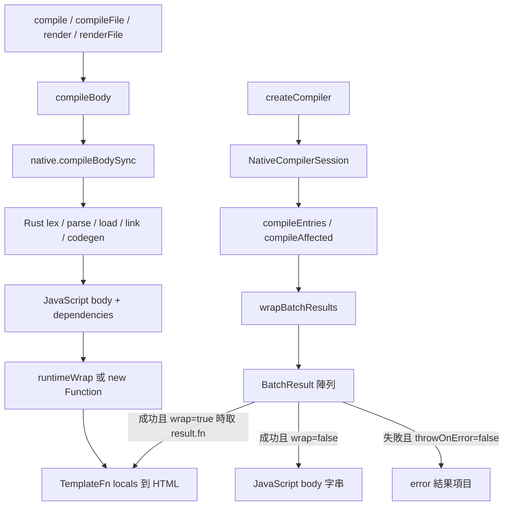

# ISMD JavaScript API、方法與型別

本文依 2026-11-16 工作目錄的原始碼整理，範圍為 `ismd/index.mjs`、`ismd/register.mjs`、`ismd/runtime/**/*.mjs`、`ismd/index.d.ts`，並對照 N-API 實作。JavaScript 主程式使用 `.mjs`；僅搜尋 `*.js` 會漏掉 API。`ismd/tests/cases/javascript-new-lines.js` 與 `ismd/tests/cases/auxiliary/includable.js` 是 include 測試素材，沒有編譯器 API 類別／方法宣告。

下列 `TemplateFn`、`CompilerFacade`、`BatchResult` 等名稱是本文用來說明實際物件形狀的型別別名，**不是專案已宣告的 TypeScript interface**。除明列「`.d.ts` 宣告」外，型別均由 JS 分支、Rust N-API DTO 與呼叫點歸納；不代表執行時有完整型別驗證。測試、benchmark、diagnostics 的測試函式／腳本 helper 不列為可供應用程式使用的 API。

## 1. 入口與呼叫流程

套件 [ismd/package.json](../../package.json#L6) 設定 `type: "module"`，開放 `ismd`、`ismd/register`、`ismd/runtime` 三個 export 路徑。載入 `ismd/index.mjs` 即執行 `loadNativeAddon()`；單獨載入 runtime 不會經過這個編譯器入口。

對照：[compileBody](../../index.mjs#L662)、[compile](../../index.mjs#L952)、[createCompiler](../../index.mjs#L1268)、[NativeCompilerSession](../../crates/ismd_napi/src/lib.rs#L1511)。所有這些 JS API 都是同步呼叫；render 的 callback overload 也是同步執行，沒有建立 Promise。

## 2. 模組匯出與 simple API

`LocalsObject` 的 `.d.ts` 宣告是 `Record<string, any>`，`compileTemplate` 是 `(locals?: LocalsObject) => string`。本文 `TemplateFn` 指此函式再附加 `dependencies: string[]`。[型別來源](../../index.d.ts#L19)

| 名稱 | Arguments | Return／值 | 實作與行為 |
|---|---|---|---|
| `name` | 無 | 實作常數 `'ISMD'` | [index.mjs:54](../../index.mjs#L54)；`.d.ts` 寫成 `'Ismd'`，與實作不同 |
| `runtime` | 無 | runtime helper 物件 | [index.mjs:55](../../index.mjs#L55)；詳見第 7 節 |
| `cache` | 無 | 無 prototype 的物件，以 filename 為 key | [index.mjs:56](../../index.mjs#L56)；內部寫入 `TemplateFn`；`.d.ts` 宣告值為 `compileTemplate \| string` |
| `compile` | `str: string`、`options?: Options` | `TemplateFn` | [index.mjs:952](../../index.mjs#L952)；實作先 `String(str)`，編譯後以 `Function` 建立函式 |
| `compileFile` | `path: string`、`options?: Options` | `TemplateFn` | [index.mjs:980](../../index.mjs#L980)；會設定傳入物件的 `options.filename`，經快取 helper 讀檔 |
| `render` | `str: string`、`options?: Options & LocalsObject` | `string` | [index.mjs:986](../../index.mjs#L986)；同一個 options 亦作為 locals 傳入模板 |
| `render` callback overload | `str`、`options` 可省略、`fn: (err: Error \| null, html?: string) => T` | `T` | 同上；成功回傳 `fn(null, html)` 的值，失敗回傳 `fn(error)` 的值 |
| `renderFile` | `path: string`、`options?: Options & LocalsObject` | `string` | [index.mjs:1009](../../index.mjs#L1009)；會修改 `options.filename` |
| `renderFile` callback overload | `path`、`options` 可省略、`fn: (err: Error \| null, html?: string) => T` | `T` | 同上；callback 同步執行 |
| `__express` | `path: string`、`options?: Options & LocalsObject`、`fn?: callback`；options 可由 callback 取代 | `undefined`（`.d.ts`: `void`） | [index.mjs:1029](../../index.mjs#L1029)；呼叫 `renderFile` 但不 return；production 且 compileDebug 未指定時設為 false |
| `createTemplateStore` | 無 | `NativeTemplateStore` 實例 | [index.mjs:1050](../../index.mjs#L1050) |
| `clearDefaultTemplateStore` | 無 | `undefined` | [index.mjs:1054](../../index.mjs#L1054)；清除 Rust global store，不清除 JS `cache` |
| `defaultTemplateStoreStats` | 無 | `StoreStats \| null` | [index.mjs:1060](../../index.mjs#L1060)；舊 addon 缺少方法時為 null |
| `getLastProfileJson` | 無 | `string \| null` | [index.mjs:1044](../../index.mjs#L1044)、[N-API Option<String>](../../crates/ismd_napi/src/lib.rs#L1343)；default export 上名稱是 `_getLastProfileJson` |
| `resolveNativePluginPath` | `plugin: string \| {nativePath?: string, path?: string} \| unknown` | `string \| null` | [index.mjs:1066](../../index.mjs#L1066)；字串依存在路徑、require.resolve、path.resolve 順序處理；字串回傳絕對路徑不保證檔案存在 |
| `resolveNativePlugins` | `plugins: unknown`，預期陣列 | `string[]` | [index.mjs:1088](../../index.mjs#L1088)；非陣列為 `[]`，逐筆收集可解析路徑 |
| `createCompiler` | `defaultOptions = {}` | `CompilerFacade` 物件 | [index.mjs:1268](../../index.mjs#L1268)；方法見第 4 節 |
| `compileBatch` | `entries: BatchEntry[]`、`defaultOptions = {}`、`compileOpts = {}` | `BatchResult[]` | [index.mjs:1376](../../index.mjs#L1376)；正常路徑呼叫 native.compileBatchSync；host customization 路徑逐筆呼叫 compile |

`resolveNativePluginPath`、`resolveNativePlugins` 是 named exports，未列入 default export。default export 另含第 6 節的低階工具；完整清單以 [index.mjs:1404](../../index.mjs#L1404) 為準。現有入口沒有匯出 `compileClient`、`compileFileClient`、`filters` 或 `CompilerSession` JS constructor；不能從舊測試／報告中的名稱推論目前仍支援。

## 3. Options：宣告與實際使用

來源：[Options 宣告](../../index.d.ts#L1)、[compile 轉換](../../index.mjs#L952)、[compileBody 的 N-API options](../../index.mjs#L839)、[batch options 轉換](../../index.mjs#L1100)。未填寫的欄位在下表稱「未指定」；不等於原始 JS 物件已有預設值。

| 欄位 | 型別 | 實際規則／預設 |
|---|---|---|
| `filename` | `string?` | 未指定；compileFile/renderFile 覆寫為 path；render 啟用 cache 時必填 |
| `basedir` | `string?` | 未指定；交給 native 作路徑解析 |
| `doctype` | `string?` | 未指定；傳入 native |
| `pretty` | `boolean \| string` | `true` 轉兩個空白；字串保留；其他值轉 undefined |
| `self` | `boolean?` | native `useSelf = Boolean(self)`，預設 false |
| `debug` | `boolean?` | simple compile 路徑 truthy 時將產生的 JS 寫入 console.error；batch 正常路徑未轉交此欄位 |
| `compileDebug` | `boolean?` | JS 封裝以 `!== false` 判斷，預設 true |
| `includeSources` | `.d.ts`: `boolean?` | simple compile 與 batch 封裝實際用 `compileDebug === true` 決定；沒有使用呼叫者傳入的 includeSources 值 |
| `globals` | `string[]?` | 非陣列轉 `[]`，陣列直接交給 N-API |
| `cache` | `boolean?` | 只有 handleTemplateCache 使用；預設不啟用 JS filename cache；compile 本身不經此 helper |
| `inlineRuntimeFunctions` | `boolean?` | native 轉 Boolean，預設 false；true 時以內嵌 runtime 的 JS 建立函式 |
| `plugins` | `.d.ts`: `any[]?` | simple compile 支援 host callbacks 與 native plugin path 收集；batch 有第 5 節限制 |
| `name`、`module` | `.d.ts`: `string?`、`boolean?` | 宣告存在，現行 compile 轉換沒有讀取它們，不能當作已實作命名／模組輸出選項 |
| `templateName` | 實作使用 `string?`，未列於 `.d.ts` | simple compile 固定 `'template'`；batch 轉換用值或 `'template'`，但 wrapper 仍取名為 template 的函式，因此不是可直接保證可用的自訂名稱 API |
| `templateStore` | `NativeTemplateStore?`，未列於 `.d.ts` | simple compile／createCompiler／compileBatch 可傳入；否則依各 native 入口選 global store 或 session 自有 store |
| `nativePlugins` | 路徑描述陣列，未列於 `.d.ts` | batch 轉換讀 `plugins \|\| nativePlugins`；simple compile 只轉交 plugins，因此單獨傳 nativePlugins 不會到 compileBody |

JS `cache` 命中判斷只比對 `pretty`、`compileDebug`、`doctype`、`self`、`inlineRuntimeFunctions` 及字串內容／entry 檔案 mtime；不檢查整份 options 或所有依賴檔。無 metadata 的外部快取值直接回傳；檔案 stat 失敗也可能回傳原快取。這是 [handleTemplateCache](../../index.mjs#L901) 的實際條件，不能視為 dependency DAG 的完整失效通知。

## 4. createCompiler 回傳物件與 NativeTemplateStore

`createCompiler()` 沒有宣告 JavaScript `class CompilerSession`。它建立 `new native.NativeCompilerSession(...)`，以 closure 保存 options 淺複製、`Map` 型態 fnCache 與 disposed flag，再回傳 object literal。下列 `CompilerFacade` 是本文稱呼。[來源](../../index.mjs#L1268)

| 方法／屬性 | Arguments | Return | 行為與來源 |
|---|---|---|---|
| `updateFiles` | `files: Record<string, string> \| Map<string, string> \| Array<{path: string, source: string}>` | `UpdateReport` | [1284](../../index.mjs#L1284)；正規化 path/source 為 String；空值輸入轉 `[]` |
| `invalidateFiles` | `paths: string \| string[]` | `UpdateReport` | [1288](../../index.mjs#L1288)；轉陣列並對每筆 String |
| `removeFiles` | `paths: string \| string[]` | `UpdateReport` | [1293](../../index.mjs#L1293)；移除符合 key 或絕對路徑小寫比對的 JS fnCache，再呼叫 native |
| `getAffectedEntries` | 無 | `string[]` | [1304](../../index.mjs#L1304)；目前待重編 entry IDs |
| `compileAffected` | `compileOpts?: BatchCompileOptions` | `BatchResult[]` | [1308](../../index.mjs#L1308)；沒有受影響 entry 即回傳 `[]` |
| `compileEntries` | `entries: BatchEntry[]`、`compileOpts?: BatchCompileOptions` | `BatchResult[]` | [1346](../../index.mjs#L1346)；正常路徑經 native session；若偵測 host customization 則逐筆 fallback |
| `compileBatch` | 同 compileEntries | `BatchResult[]` | [1343](../../index.mjs#L1343)；呼叫 `this.compileEntries`，故取出方法單獨呼叫會失去所需 this |
| `clear` | 無 | `undefined` | [1322](../../index.mjs#L1322)；清空 fnCache 並呼叫 session.clear |
| `dispose` | 無 | `undefined` | [1327](../../index.mjs#L1327)；設 disposed、清 fnCache、呼叫 native dispose；可重複呼叫 |
| `isDisposed` getter | 無 | `boolean` | [1333](../../index.mjs#L1333)；回傳 closure flag |
| `stats` | 無 | `StoreStats & {fnCache: number}` | [1336](../../index.mjs#L1336)；沒有 assertAlive，因此 dispose 後仍會查 native stats |

除了 dispose、isDisposed、stats，操作會經 `assertAlive()`；dispose 後丟出 `Error('CompilerSession has been disposed')`。`compileBatch` 經 compileEntries 間接檢查。[來源](../../index.mjs#L1277)

`createTemplateStore()` 回傳 N-API class 實例，不是 CompilerFacade。方法名稱由 N-API 映射為 camelCase，並有 [template-store 測試](../../tests/integration/template-store.test.mjs#L36) 使用佐證。

| NativeTemplateStore 方法 | Arguments | Return | 原始碼 |
|---|---|---|---|
| constructor（由 createTemplateStore 包裝） | 無 | `NativeTemplateStore` | [N-API:1227](../../crates/ismd_napi/src/lib.rs#L1227) |
| `invalidatePath` | `path: string` | `undefined` | [N-API:1234](../../crates/ismd_napi/src/lib.rs#L1234) |
| `updateVirtualSource` | `path: string, source: string` | `undefined` | [N-API:1239](../../crates/ismd_napi/src/lib.rs#L1239) |
| `clear` | 無 | `undefined` | [N-API:1244](../../crates/ismd_napi/src/lib.rs#L1244) |
| `stats` | 無 | `StoreStats` | [N-API:1249](../../crates/ismd_napi/src/lib.rs#L1249) |

`StoreStats` 的所有欄位在 JS 都是 `number`：`sources`、`parsed`、`resolved`、`outputs`、`dagNodes`、`dagEdges`、`sourceHits`、`sourceMisses`、`parseHits`、`parseMisses`、`outputCacheHits`、`outputCacheMisses`。前六欄 Rust 為 u32，其餘為 f64；CompilerFacade 額外加入 JS Map 大小 `fnCache`。[DTO](../../crates/ismd_napi/src/lib.rs#L1185)

`UpdateReport = {changed: boolean, changedFiles: string[], invalidatedTemplates: string[], affectedEntries: string[]}`，對應 [NapiIncrementalUpdateReport](../../crates/ismd_napi/src/lib.rs#L1492)。

`affectedEntries` 是這次異動找到的 entry IDs；`getAffectedEntries()` 是尚未編譯的累積 pending IDs。`invalidatedTemplates` 是沿依賴圖收集的路徑，不代表每個路徑都已從所有 cache 刪除。`updateFiles` 的 `changed` 比對內容 hash／長度；`invalidateFiles`／`removeFiles` 依已知 path ID 判斷，不會自行讀檔確認磁碟內容是否改變。[session.rs](../../crates/ismd_compiler/src/session.rs#L128)、[build_invalidation_report](../../crates/ismd_compiler/src/session.rs#L266)

## 5. Batch 輸入、結果與分支差異

`BatchEntry` 是 filename 字串，或 `{id?: string, filename?: string, source?: string, options?: Options}`。字串轉 `{id: entry, filename: entry}`；物件 id 依 `id || filename || "entry_<index>"` 決定，index 從 0 起。正常路徑會把 entry.options 獨立轉成 N-API options。[normalizeBatchEntries](../../index.mjs#L1141)

| BatchCompileOptions 欄位 | 型別／預設 | 行為 |
|---|---|---|
| `wrap` | `boolean?`，預設 true | false 時正常路徑只回傳 JS body，不產生 fn |
| `throwOnError` | `boolean?`，預設 true | false 時編譯失敗回傳 error entry；true 於處理失敗 entry 時丟出 |
| `parallel` | `boolean \| number` | true/false 強制平行／循序；number 為自動平行門檻 |
| `parallelThreshold` | `number?` | parallel 非 boolean/number 時交給 native 作門檻；未指定為 8 |

依據：[wrapBatchResults](../../index.mjs#L1171)、[compileEntries](../../index.mjs#L1346)、[N-API 平行模式](../../crates/ismd_napi/src/lib.rs#L1599)、[DEFAULT_PARALLEL_THRESHOLD](../../crates/ismd_compiler/src/session.rs#L14)。平行處理發生在 Rust 內，JS 呼叫仍同步。

| BatchResult 分支 | 物件欄位與型別 |
|---|---|
| 正常成功且 wrap=true | `{id: string, ok: true, fn: TemplateFn, body: string, dependencies: string[], cacheHit: boolean}` |
| 正常成功且 wrap=false | `{id: string, ok: true, body: string, dependencies: string[], cacheHit: boolean}` |
| 失敗且 throwOnError=false | `{id: string, ok: false, error: Error, dependencies: []}`；fallback 的 catch 實際可保留 plugin 拋出的非 Error 值 |
| JS host fallback 成功 | `{id: string, ok: true, fn: TemplateFn, dependencies: string[]}`，沒有 body/cacheHit |

來源：[wrapBatchResults](../../index.mjs#L1171)、[compileBatchFallbackEntry](../../index.mjs#L1245)。`throwOnError: false` 控制已轉成結果的編譯錯誤，不代表所有 JS 型別錯誤、N-API 失敗或 wrap 建立函式的錯誤都會轉成結果。

需維護者注意的已查證差異：

- [hasHostCustomizations](../../index.mjs#L1116) 只檢查 `postLoad`、`preTransform`、`postTransform`、`preLink`、`postLink`、`preCodeGen`、`postCodeGen`、`lex`。單獨使用 `preLex`、`postLex`、`preParse`、`postParse`、`preLoad`、`resolve`、`read`、`generateCode` 不會觸發 fallback；normal batch 路徑也沒有傳 JS callbacks。
- fallback 會逐筆同步 `compile()`，讀檔使用 `fs.readFileSync`；忽略 wrap=false 與 parallel，亦不透過 native session 註冊 entry，因此不能假設具有相同 compileAffected 行為。[fallback](../../index.mjs#L1245)
- fallback 的 options 使用 `{...baseOptions, ...entry.options, filename}` 合併；normal batch 在 Rust 選取整份 entry.options，若存在便取代 default_options，不做逐欄合併。[session.rs:479](../../crates/ismd_compiler/src/session.rs#L479)
- `compileAffected()` 沒有原 entries 的 per-entry options 陣列，wrap 的 inline 判斷使用 session defaults；不要推論所有不同 entry options 都會由 wrapper 保留。[1308](../../index.mjs#L1308)、[1185](../../index.mjs#L1185)

## 6. 低階編譯與 AST 工具

這些函式有實際 JS exports，但未列於 `index.d.ts`。`AstNode` 在此指 Rust AST 的序列化物件，辨別欄位為 `type`；詳細變體見 [ismd_ast/ast.rs](../../crates/ismd_ast/src/ast.rs) 與 [Rust API 文件](rust-api.md)。

| 匯出名稱（別名） | Arguments | Return | 原始碼與規則 |
|---|---|---|---|
| `_error` | `code, message` 會 String；`options?: {line?: number, column?: number, filename?: string, src?: string}` | 附 ISMD 欄位的 `Error` | [makeError:59](../../index.mjs#L59)；line 預設 0 |
| `_runtimeBuild` | `fns: string[]` | `string`（runtime JS source） | [89](../../index.mjs#L89)，呼叫 native.runtimeBuild |
| `_runtimeBuildJs` | `functions: string[]` | `string` | [runtime/build.mjs:5](../../runtime/build.mjs#L5)，JS 版本 |
| `lex`、`_lex` | `str: string`、`options?: {filename?: string, interpolated?: boolean, startingLine?: number, startingColumn?: number, plugins?: object[]}` | `Token[]` | [211](../../index.mjs#L211)；非 string source／非 object options 丟 Error；line/column 原生預設 1 |
| `stripComments`、`_stripComments` | `input: Token[]`、`options?: {stripUnbuffered?: boolean, stripBuffered?: boolean, filename?: string}` | `Token[]` | [246](../../index.mjs#L246)；預設刪 unbuffered、保留 buffered |
| `parse`、`_parse` | `tokens: Token[]`、`options?: {filename?: string, src?: string}` | `AstNode`（解析入口 block） | [269](../../index.mjs#L269)；tokens 必須是陣列；warning 經 console.warn |
| `walk`、`_walk` | `ast: AstNode`、`before?: Visitor`、`after?: Visitor \| WalkOptions`、`options?: WalkOptions` | `AstNode` | [298](../../index.mjs#L298)；第三參數可直接是 options |
| `_load` | `ast: AstNode`、`options: LoadOptions` | `AstNode` | [445](../../index.mjs#L445)；透過 resolve/read/parseSource callbacks 載入依賴 |
| `_link` | `ast: AstNode` | `AstNode` | [568](../../index.mjs#L568)；Buffer bridge 後呼叫 native.linkSync |
| `_addWith` | `obj: string`、`src: string`、`exclude?: string[]` | `string` | [560](../../index.mjs#L560)；前兩項 String，exclude 非陣列為 `[]` |
| `_compileAttrs` | `attrs: Array<{name: string, val: string \| boolean, mustEscape: boolean}>`、`options: {terse: boolean, format: 'html' \| 'object', runtime: (name: string) => string}` | `string`（JS expression source） | [578](../../index.mjs#L578)；驗證 attrs 與 options 後呼叫 native.compileAttrsSync |

`Token` 主要欄位為 `type: string`、`loc: {start: {line:number,column:number}, end: 同型別, filename?: string}`；其餘可選欄位為 `val/args/key: JSON value`、`name/mode/code/value: string`、`mustEscape/buffer/selfClosing: boolean`。座標預設從 1 起，可由 lexer 的 startingLine／startingColumn 指定起點；column 採 UTF-16 code unit。[token.rs](../../crates/ismd_ast/src/token.rs#L9)、[span.rs](../../crates/ismd_ast/src/span.rs#L4)、[Lexer::create_inner](../../crates/ismd_lexer/src/lib.rs#L208)

`Visitor = (node: AstNode, replace: Replace) => unknown`。before 回傳 `false` 停止走訪該節點子樹；after 回傳值不使用。`Replace = (replacement: AstNode | AstNode[]) => void`，帶 `arrayAllowed: boolean` 屬性；只有 native 標示容許陣列時才能替換陣列，否則丟錯。`WalkOptions = {includeDependencies?: boolean, parents?: AstNode[]}`；預設不走 dependency，parents 陣列在 callback 期間就地更新，成功結束後還原初始內容。[walkAST](../../index.mjs#L298)

`LoadOptions` 必須是 object，包含 `lex: (source, options) => Token[]` 與 `parse: (tokens, options) => AstNode`；可指定 `filename/basedir/src`、`resolve: (filename, source, options) => string`、`read: (filename, options?) => Buffer | string`。read 亦會接受能 `.toString('utf8')` 的物件。低階 `_load` 不會自動補入 lex/parse。[validateOptions](../../index.mjs#L524)

| `_load` 函式物件附加方法 | Arguments | Return | 原始碼 |
|---|---|---|---|
| `.string` | `src: string, options: LoadOptions` | `AstNode` | [489](../../index.mjs#L489)；lex → parse → load |
| `.file` | `filename: string, options: LoadOptions` | `AstNode` | [498](../../index.mjs#L498)；read → string |
| `.resolve` | `filename: string, source?: string, options?: {basedir?: string}` | `string` | [506](../../index.mjs#L506)；native.defaultResolveSync |
| `.read` | `filename: string` | `Buffer` | [520](../../index.mjs#L520)；fs.readFileSync |
| `.validateOptions` | `options: unknown` | `undefined` 或丟 TypeError | [524](../../index.mjs#L524) |

## 7. Runtime 與 register

`ismd/runtime` 提供下列 named exports 與包含相同方法的 default object。型別是由實作推導，並非 `.d.ts` 為每個 helper 宣告的精確型別。

| 方法 | Arguments | Return | 實作 |
|---|---|---|---|
| `merge` | `a: object, b: object`；或 `a: object[]` 單參數 | 合併後的第一個物件；空單參數陣列為 undefined | [runtime/index.mjs:18](../../runtime/index.mjs#L18)；原地修改，class 合併陣列，style 串接 |
| `classes` | `val: string \| unknown[] \| Record<string, unknown>`、`escaping?: boolean[]` | 合法預期輸入為 `string`；其他 truthy primitive 會直接原值返回 | [87](../../runtime/index.mjs#L87)；陣列遞迴，物件取 truthy 自有 key |
| `style` | `val: object \| string`（也可傳其他值） | `string` | [104](../../runtime/index.mjs#L104)；falsy 轉空字串、物件轉 CSS 宣告 |
| `attr` | `key: string, val: unknown, escaped: boolean, terse: boolean` | `string` | [129](../../runtime/index.mjs#L129)；可能呼叫 toJSON/JSON.stringify，非任意物件都保證成功 |
| `attrs` | `obj: Record<string, unknown>, terse: boolean` | `string` | [164](../../runtime/index.mjs#L164)；走訪自有屬性，class 優先放前面 |
| `escape` | `_html: unknown`，預期可轉字串 | 原輸入型別或 `string` | [195](../../runtime/index.mjs#L195)；若沒有 `"&<>`，直接 return 原輸入，不能無條件標為 string |
| `rethrow` | `err: unknown, filename?: string, lineno: number, str?: string` | `never`（丟出） | [238](../../runtime/index.mjs#L238)；附加原始碼上下文，必要時讀 filename；非 Error 直接 throw |

內部 `ismd_classes_array(val: unknown[], escaping?: boolean[]): string`、`ismd_classes_object(val: object): string` 是 classes 的 helper，未匯出。[62](../../runtime/index.mjs#L62)、[76](../../runtime/index.mjs#L76)

`runtime/wrap.mjs` 的 default `wrap(template: string, templateName?: string): Function` 以 `Function('ismd', source)(runtime)` 取得指定名稱函式，名稱預設 template。[wrap:3](../../runtime/wrap.mjs#L3)

`runtime/build.mjs` 的 default `build(functions: string[]): string` 依 [dependencies.mjs](../../runtime/lib/dependencies.mjs#L1) 遞迴收集 helper、排除 [internals.mjs](../../runtime/lib/internals.mjs#L1) 的入口項目，依 helper 名稱排序後取出 [sources.mjs](../../runtime/lib/sources.mjs#L1) 的 JS 字串串接，並非排序原始碼字串本身。這三個 lib 模組匯出資料物件，沒有獨立類別；sources 的 function 文字是產生程式碼素材。[build 實作](../../runtime/build.mjs#L5)

`ismd/register` 的 named/default export 是 `compileTemplate(module: {exports: unknown}, filename: string): void`，將 `module.exports` 設成 `ismd.compileFile(filename)`。載入模組時，若 `require.extensions` 存在，便設定 `require.extensions['.ismd']`。這是 CommonJS extension hook，不是自訂 ESM loader。[register.mjs:6](../../register.mjs#L6)

## 8. Host plugin callback 與內部方法

simple compile 的 [compileBody](../../index.mjs#L662) 會建立 callbacks；各 hook 透過 `applyPlugins` 依 plugins 陣列順序傳遞回傳值。下面是 JS bridge 的參數／回傳要求，不是 TypeScript 已宣告的 plugin interface。

| hook | Arguments | Return |
|---|---|---|
| `preLex` | `source: string, options: {filename?: string}` | `string` |
| `postLex`、`preParse` | `tokens: Token[], options`（附 filename/src） | `Token[]` |
| `postParse`、`preLoad` | `ast: AstNode, options`（附 filename/src） | `AstNode` |
| `postLoad`、`preTransform`、`postTransform`、`preLink`、`postLink`、`preCodeGen` | `ast: AstNode, options` | `AstNode` |
| `postCodeGen` | `js: string, options` | `string` |
| `resolve` | `targetPath: string, source: string \| null, options` | 可 String 的值，預期 path 字串 |
| `read` | `fullPath: string, options` | `Buffer \| string` 或可 toString('utf8') 的值 |
| `generateCode` | `ast: AstNode, codegenOptions` | `string` |
| `lex[method]` | `proxy: LexerProxy` | truthy 表示已處理，falsy 讓下一個 plugin 嘗試 |

resolve/read/generateCode 同一種替換函式最多一個 plugin 提供，重複時 `findReplacementFunc` 丟 Error。[630](../../index.mjs#L630)；generateCode 收到 pretty/compileDebug/doctype/inlineRuntimeFunctions/globals/self/includeSources/templateName 欄位。[819](../../index.mjs#L819)

`LexerProxy` 由 [buildLexPluginBridge](../../index.mjs#L114) 建立，有 input、filename、lineno、colno、interpolated、tokens、ended 狀態，方法如下：

| 方法 | Arguments | Return／效果 |
|---|---|---|
| `tok` | `type: string, val?: unknown` | token 物件，含 loc.start；val 未指定時不加入 |
| `tokEnd` | `tok: Token` | 同一個 token，設定 loc.end |
| `consume` | `len: number` | `undefined`；input = input.substr(len) |
| `incrementColumn` | `inc: number` | `undefined`；colno += inc |
| `incrementLine` | `inc: number` | `undefined`；lineno += inc，inc truthy 時 colno=1 |
| `error` | `code: string, message: string` | `never`；附目前位置丟錯 |

bridge 的 `step(method: string, state: object)` 回傳 `{handled: boolean, state: object}`；未有 loc.end 的 token 會補上與 loc.start 相同的位置。這些是 proxy object methods，不是已宣告 Lexer JS class。

以下列出入口檔具名的內部 helper，方便由功能反查原始碼：

| helper | Arguments | Return／目的 |
|---|---|---|
| [loadNativeAddon](../../index.mjs#L13) | 無 | native addon exports；依 profile 路徑或候選 .node/.dll 載入 |
| [dtoToJsError](../../index.mjs#L94) | `dto: NapiIsmdErrorDto` | 附 ISMD 欄位與 toJSON 的 Error |
| [reviveAstBuffers](../../index.mjs#L392) | `val: unknown` | 同值／物件；原地把 FileReference.raw 的 Buffer DTO 還原 |
| [dehydrateAstBuffers](../../index.mjs#L421) | `val: unknown` | 轉成可傳遞的物件／陣列，FileReference.raw 轉 BufferBase64；忽略物件中 undefined/function/symbol 欄位 |
| [getLoadOptions](../../index.mjs#L542) | `options: LoadOptions` | 驗證後的淺複製物件，補預設 resolve/read |
| [applyPlugins](../../index.mjs#L624) | `value: unknown, options: object, plugins: object[], name: string` | reduce 後的值 |
| [findReplacementFunc](../../index.mjs#L630) | `plugins: object[], name: string` | 綁定 plugin 的 Function 或 null；重複則 throw |
| [normalizePretty](../../index.mjs#L642) | `pretty: unknown` | `string \| undefined` |
| [defaultWarn](../../index.mjs#L648) | `msg: unknown` | `undefined`，console.warn |
| [hasPluginHook](../../index.mjs#L652) | `plugins: object[], name: string` | `boolean` |
| [compileBody](../../index.mjs#L662) | `str: string, options: object` | `{body: string, dependencies: string[]}` 或 throw |
| `compileBody.fileOpts` | `filename: string \| null, src: string \| null` | options 淺複製，非 null 值覆寫；[686](../../index.mjs#L686) |
| [handleTemplateCache](../../index.mjs#L901) | `options: object, str?: string` | 編譯函式，或使用者預先放入 cache 的值 |
| [toNapiCompileOptions](../../index.mjs#L1100) | `options = {}` | 對應 NapiCompileOptions 的 JS object |
| [hasHostCustomizations](../../index.mjs#L1116) | `options?: object` | `boolean`；精確偵測集合見第 5 節 |
| [normalizeBatchEntries](../../index.mjs#L1141) | `entries: BatchEntry[]` | 正規化後 entry object 陣列 |
| [batchResultToError](../../index.mjs#L1160) | native result object | `Error` |
| [wrapBatchResults](../../index.mjs#L1171) | `rawResults: object[], defaultOptions: object, compileOpts = {}` | `BatchResult[]`；內部亦可接 entries、fnCache |
| [normalizeVirtualFiles](../../index.mjs#L1228) | 檔案 object／Map／陣列／空值 | `{path: string, source: string}[]` |
| [compileBatchFallbackEntry](../../index.mjs#L1245) | `e: BatchEntry, i: number, baseOptions: object, compileOpts = {}` | 單筆 fallback success/error result |
| `createCompiler.assertAlive` | 無 | `undefined` 或 throw；[1277](../../index.mjs#L1277) |

## 9. 錯誤、宣告落差與驗證邊界

一般編譯錯誤會從 N-API 的 `error` DTO 建立 Error，附 `code: string`、`msg: string`、`line: number`、`column?: number`、`filename?: string`、`src?: string`；`toJSON(): object` 僅回傳 code/msg/line/column/filename，不含 src/message。plainError 則建立一般 Error，compileBody 與 batch 另保留 plainErrorCode 至 err.code。[makeError](../../index.mjs#L59)、[compileBody error mapping](../../index.mjs#L859)、[batchResultToError](../../index.mjs#L1160)

| 階段 | 錯誤處理與部分成功的含義 |
|---|---|
| `compile`／`compileFile` | 編譯或建立函式時直接 throw；成功回傳的 `fn(locals)` 若之後執行失敗，需在呼叫 `fn` 時另行 catch |
| `render`／`renderFile` | 同步版本直接 throw；callback 版本把編譯及模板執行錯誤傳入 callback，回傳 callback 的值；callback 自己丟出的例外直接向外傳遞 |
| native batch | Rust 先收集本批所有結果，再由 JS `wrapBatchResults` 逐筆處理。預設遇到失敗項會 throw，呼叫端拿不到部分結果陣列；其他項目可能已完成編譯並寫入快取，不是整批 rollback |
| JS host fallback batch | 逐筆 `compile`；預設遇錯立即 throw，後續項目不再執行。`throwOnError:false` 才保留失敗項並繼續 |
| `throwOnError:false` | 只控制結果錯誤的處理；正常 native 路徑的 wrapper `Function` 建立失敗、N-API 呼叫本身失敗，以及稍後的 `result.fn(locals)` 錯誤仍須另行 catch |

依據：[render](../../index.mjs#L986)、[wrapBatchResults](../../index.mjs#L1171)、[fallback](../../index.mjs#L1245)、[compile_batch_with_mode](../../crates/ismd_compiler/src/session.rs#L405)。`compileAffected` 在編譯前就消耗 pending，失敗不會自動重新排隊；明確重試方式見 [維護指引](developer-guide.md)。

`compileDebug` 啟用時，codegen 在生成函式內加入 try/catch 並呼叫 runtime `rethrow`，補充檔名／行號與來源上下文；關閉時沒有這層包裝。`rethrow` 重新丟出原錯誤，未保證新增 ISMD `code` 或 `toJSON`，因此模板執行錯誤不能一律當作 `NapiIsmdErrorDto`。來源：[CodeGenerator::finish](../../crates/ismd_code_gen/src/lib.rs#L1162)、[runtime.rethrow](../../runtime/index.mjs#L238)。

`index.d.ts` 只有 Options、LocalsObject、compileTemplate、name/cache/runtime 與 simple API；未描述本文件的 store/session/batch/低階 API，也沒有完整 runtime method signature。name 大小寫、includeSources/name/module、cache 可存 string 等處以實作為準；本次文件不修改宣告檔。[index.d.ts](../../index.d.ts#L1)

可供維護者追查的現有測試：[js-api.test.mjs](../../tests/integration/js-api.test.mjs)、[compiler-session.test.mjs](../../tests/integration/compiler-session.test.mjs)、[template-store.test.mjs](../../tests/integration/template-store.test.mjs)、[load.test.mjs](../../tests/integration/load.test.mjs)、[attrs-codegen.test.mjs](../../tests/integration/attrs-codegen.test.mjs)。這些是原始碼對照點，本文不把未於本次執行的測試宣稱為通過，也不把舊測試中已無對應 export 的 API 宣稱仍可用。
